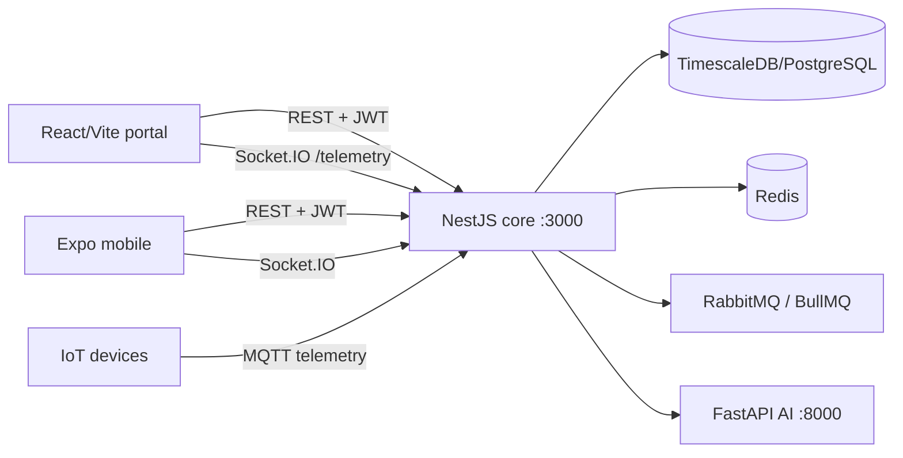

# Architecture

`AppModule` nạp Auth, Redis, Queue, notifications, users, farms, ponds, crops, devices, alerts, predictions và telemetry. HTTP security/configuration nằm ở `src/http-app.config.ts`; Swagger được dựng tại `/api/docs`. Telemetry gateway xác thực JWT trước Socket.IO subscription. AI live health service is available, while no water-quality prediction endpoint/model is deployed. AQS-101A recovered a separate Python environment and confirmed local telemetry availability; it did not establish a model target or inference path.

## AQS-101D correction

The preceding AI endpoint sentence is historical. Current FastAPI source serves an experimental research endpoint and an intentionally gated `/api/predict` endpoint. The runtime path remains `Core → FastAPI 503 → Core heuristic fallback`; it does not yet include an approved FastAPI risk result, Core `AI_MICROSERVICE` persistence, or alert dispatch. A production path needs both separately approved model metadata and an approved versioned risk ruleset.

Chi tiết dependency: [DEPENDENCY_MAP](DEPENDENCY_MAP.md). Không xác minh runtime-to-runtime connectivity vì Docker API bị từ chối truy cập trong audit.
