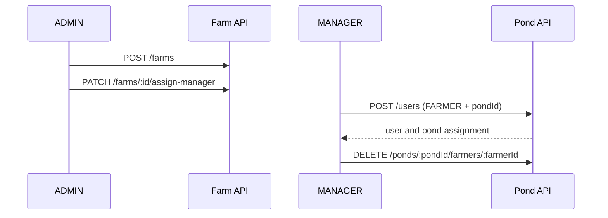
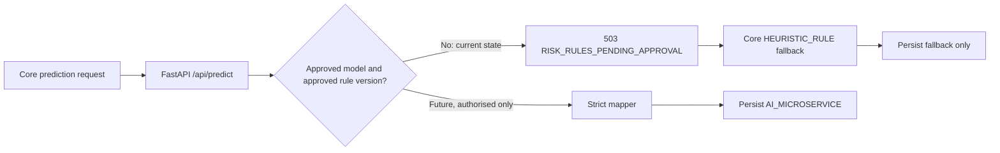

# Business Flows

## Farm → Manager → Farmer → Pond (source evidence)

Source `UsersService` requires a manager-created user to be a `FARMER` with a pond managed by that manager, then creates assignment. Admin may revoke manager at `PATCH /farms/:farmId/revoke-manager`; farm remains and ponds move to acting admin. Note: diagram label represents `pond_farmer_assignments` (spacing in diagram avoids renderer ambiguity).

## Telemetry and alerts

IoT publishes to `telemetry/devices/+/data` → `TelemetryMqttService` validates DTO → transaction writes a receipt (`deviceId`,`messageId`) and telemetry → publishes ACK only after commit → Redis realtime publish/Socket gateway → evaluates thresholds → atomic Redis cooldown → alert/notification pipeline. Unknown devices are rejected. MQTT/infrastructure runtime not verified in audit.

## Prediction

Admin/manager triggers prediction endpoint → prediction processor queue/service → configured AI URL → strict response adapter → persists `ai_prediction`/returns API result. The adapter maps `SAFE/WARNING/DANGER` to domain `LOW/MEDIUM/HIGH` and percentage risk to decimal risk; HTTP, timeout, parse and contract violations fall back to the deterministic heuristic. AQS-101B/C added a separate FastAPI research forecast (real experimental DO/pH inference) but production `/api/predict` intentionally returns `503 RISK_RULES_PENDING_APPROVAL`; Core therefore follows the verified heuristic path and does not persist an AI source. Operational risk/persistence integration remains pending approval.

## AQS-101D production gate

## AQS-101E/F/G approval boundary

The model robustness audit found no held-out low-DO target cases and no eligible multi-period rolling-origin fold. The policy review gathered contextual references but deliberately selected no numeric production rule. Therefore the approved operational sequence is still: Core request → FastAPI 503 → strict Core fallback. An owned FastAPI release, model acceptance, governed rule approval and isolated Core/FastAPI/PostgreSQL success-path test are all required before this flow may persist an AI result or emit an AI-driven alert.

The lower future branch has not been executed and must remain unavailable until independent model acceptance, rules approval and an isolated persistence E2E test are complete. Core telemetry threshold alerts are separate from forecast risk: `threshold_config` has no rule version or approval metadata.

## AQS-101K payload decision

Before the HTTP branch, Core now checks the complete FastAPI request contract. Incomplete/invalid sensor values take the existing local fallback branch without a network request, so a Core-originated missing field cannot be misclassified as an AI outage or a successful AI result. Complete requests can receive the intentional production 503; all non-success status codes still persist only `HEURISTIC_RULE` after an approved isolated database test is available.
